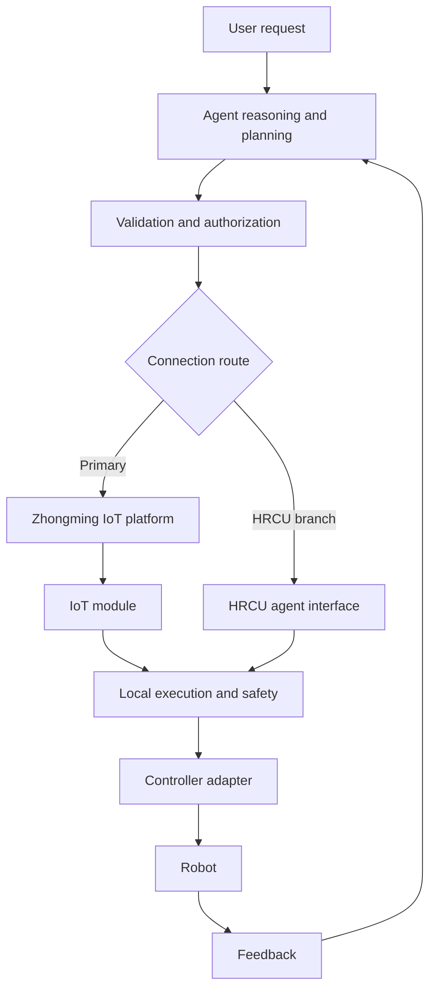

# IN-ARS
### IN — Autonomous Robotics System

IN-ARS is a research architecture for connecting agent platforms with robotic systems. The project is currently at the **conceptual design and validation-planning stage**. Compatibility and deployment are not yet claimed.

## Architecture: IoT-first, with an HRCU direct-connect branch

- **Primary route:** An agent interprets the user request, creates a structured task, and communicates through the Zhongming IoT platform and IoT module. A local execution layer validates the task before passing it to the controller.
- **Special route:** HRCU may be investigated for direct agent-platform integration, subject to official interface availability, permissions, and testing.
- **Shared safeguards:** Both routes use the same task model, validation, local safety supervision, execution feedback, and exception handling.

## Initial research targets

- Controllers: E6, E7, HRCU, M6, M5
- Zhongming IoT platform and IoT module
- Multiple agent frameworks connected through a common task interface

Official links:
- [Zhongming IoT platform](https://iot.zmrobo.com/?lang=zh-CN)
- [Zhongming website](https://zmrobo.com)

Specific APIs, MQTT settings, topics, authentication methods, and controller capabilities must be verified against official documentation and controlled tests. No compatibility is assumed.

## Safety principles

- Cloud messages must never directly control the real-time motor loop.
- Validate task format, permissions, operating bounds, robot state, and timeouts locally.
- Keep a human-accessible stop method during testing.
- Begin with simulation or a low-risk, controlled test environment.
- Never commit credentials or access tokens to the repository.

**Status:** Concept design · Technical research · Interface validation pending
